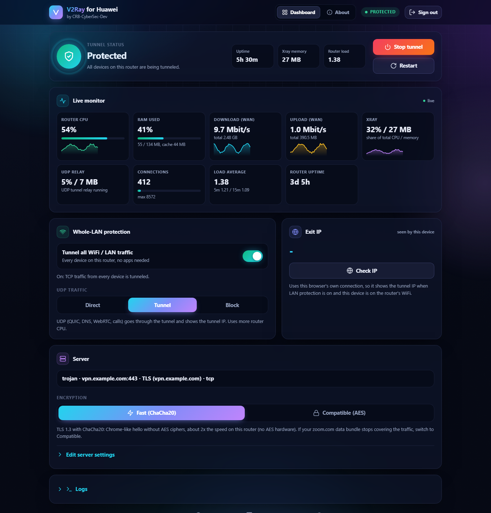
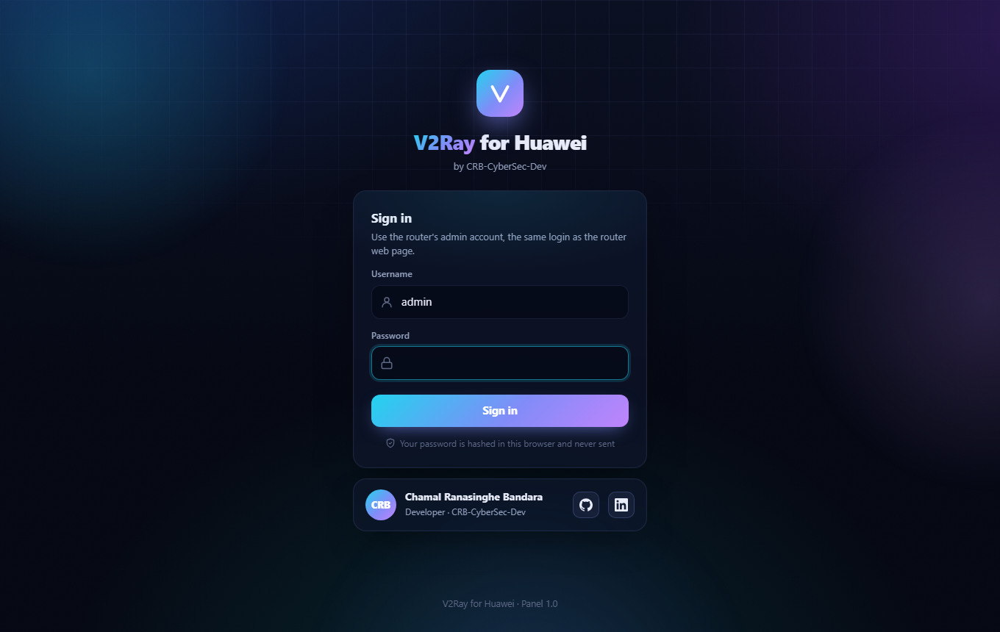
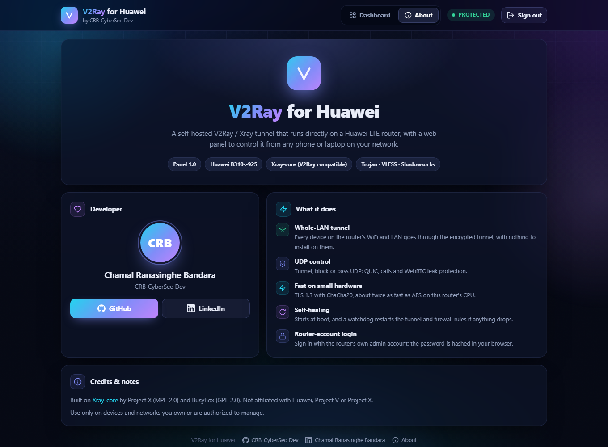
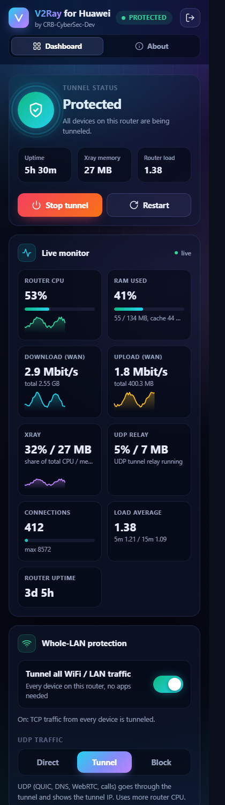

<div align="center">

# V2Ray for Huawei

**A self-hosted V2Ray / Xray tunnel that runs directly on a Huawei LTE router, with a web panel to control it from any phone or laptop on your network.**

by [CRB-CyberSec-Dev](https://github.com/CRB-CyberSec-Dev/)



</div>

## What it does

- **Whole-LAN tunnel**: every device on the router's WiFi and LAN goes through the tunnel (transparent redirect), with nothing to install on the devices.
- **UDP control**: tunnel UDP (QUIC, calls, games) through the server, block it to stop WebRTC IP leaks, or let it go direct.
- **Fast on small hardware**: a patched Xray adds a `chrome-chacha` TLS fingerprint (Chrome's hello without AES suites), so servers pick ChaCha20-Poly1305. On this router's Cortex-A9, which has no AES instructions, that is about twice the tunnel speed of AES-GCM.
- **Trojan, VLESS and Shadowsocks**: paste a share link in the panel to switch servers.
- **Self-healing**: starts at boot; a watchdog restarts Xray, the UDP relay, the firewall rules and the panel if anything drops.
- **Router-account login**: the panel signs you in with the router's own admin account. The password is hashed in the browser with the router's challenge scheme and never crosses the network.
- **Live monitor**: CPU, RAM, WAN throughput, Xray share, connections, all from the router itself.

| Sign in | About | Phone |
|---|---|---|
|  |  |  |

## Supported routers

| Router | Firmware | Status |
|---|---|---|
| Huawei B310s-925 | 21.321.03.01.1226 with root (telnet/adb + `/system/etc/autorun.sh`) | Working, used daily |
| Other Huawei LTE routers (B310/B311/B315/B525/E5186...) | Needs a root shell and a boot hook | Not tested: follow [AGENTS.md](AGENTS.md) to port |

Porting to another router is documented step by step in **[AGENTS.md](AGENTS.md)**, written so that a human or an AI coding agent can follow it on a new device.

## Requirements

- Root shell on the router (`adb` on port 5555 or telnet). The B310s needs firmware that enables it and runs `/system/etc/autorun.sh` at boot.
- About 40 MB free on `/system` for the Xray binary (`busybox df -k /system`).
- A Trojan, VLESS or Shadowsocks server you're allowed to use.
- On your PC: `adb`, and `bash` (Linux, macOS, or Git Bash on Windows).

## Install

1. Download `xray` and `udprelay` from the [latest release](https://github.com/CRB-CyberSec-Dev/v2ray-for-huawei/releases/latest) into `bin/` in this repo (ARMv7, statically linked), or [build them](#build-the-binaries).
2. With the router reachable over adb:

   ```bash
   install/deploy.sh 192.168.8.1        # your router's LAN IP
   ```

   The installer copies everything to the router, creates `/data/xray`, adds the boot hook and starts the tunnel. It's idempotent: run it again to update.
3. Open **http://192.168.8.1:8081**, sign in with the router admin account, open **Server → Edit server settings** and paste your `trojan://`, `vless://` or `ss://` link.
4. Turn on **Whole-LAN protection** to send every device through the tunnel.

## How it works

```
 LAN devices ──► br0 ──► iptables nat PREROUTING
                           ├─ TCP ─► REDIRECT :12345 ─► xray (dokodemo-door) ─┐
                           └─ UDP ─► REDIRECT :12346 ─► udprelay ─► xray SOCKS5 UDP ─┤
                                                                                     ▼
                                              xray outbound (trojan / vless / ss over TLS 1.3) ─► wan0 ─► your server
 Panel: busybox httpd :8081 ─► CGI scripts ─► control the scripts above
 Login: login.cgi ─► router web UI /api/user/login (the router checks the password)
```

| Path on router | Contents | Mount |
|---|---|---|
| `/system/xray/` | binaries, scripts, panel pages, CGIs | read-only (remounted rw only by the installer) |
| `/data/xray/` | `xray.conf`, generated `config.json`, on/off state, logs | read-write, survives reboot |
| `/tmp/xraypanel/` | login sessions | RAM, cleared at reboot |

Proxies on the router for apps that want one: SOCKS5 `:1080` and HTTP `:1081`.

## Build the binaries

```bash
# Xray with the chrome-chacha fingerprint
git clone --branch v26.10.31 --depth 1 https://github.com/XTLS/Xray-core
cd Xray-core
git apply ../src/xray-patch/xray-chrome-chacha.patch
CGO_ENABLED=0 GOOS=linux GOARCH=arm GOARM=7 go build -trimpath -ldflags "-s -w -buildid=" -o ../bin/xray ./main
cd ..

# UDP relay (LAN UDP -> xray SOCKS5 UDP ASSOCIATE)
cd src/udprelay
CGO_ENABLED=0 GOOS=linux GOARCH=arm GOARM=7 go build -trimpath -ldflags "-s -w" -o ../../bin/udprelay .
```

Xray-core v26.10.31 needs Go 1.27 (Go fetches the toolchain automatically).

## Tools

| Tool | Purpose |
|---|---|
| `tools/cipherbench` | AEAD throughput on the router, to choose ChaCha20 vs AES |
| `tools/bench.py` | download speed direct vs through the router tunnel (`ROUTER=192.168.8.1`) |
| `tools/trojan_bench.py` | Trojan speed from the PC, bypassing the router, to find the bottleneck |
| `tools/stun.py`, `tools/socks_udp_stun.py` | check your public IP over UDP, directly and through the tunnel |
| `tools/split_huawei.py` | split a Huawei `.BIN` update image into its parts (for porting research) |

## Security notes

- The panel is served on the LAN only. Every action needs a session; sessions expire after 1 hour idle or 24 hours.
- Login goes through the router's own login API, so its lockout after failed attempts applies to the panel too.
- Your server settings live only on the router in `/data/xray/xray.conf`. Never commit that file; `.gitignore` excludes it.

## Credits

- [Xray-core](https://github.com/XTLS/Xray-core) by Project X (MPL-2.0). `src/xray-patch` is a patch against it and is under the same license.
- BusyBox (GPL-2.0) on the router.

Not affiliated with Huawei, Project V or Project X. Use only on devices and networks you own or are authorized to manage.

## Author

**Chamal Ranasinghe Bandara**, [CRB-CyberSec-Dev](https://github.com/CRB-CyberSec-Dev/) · [LinkedIn](https://www.linkedin.com/in/chamal-bandara/)
